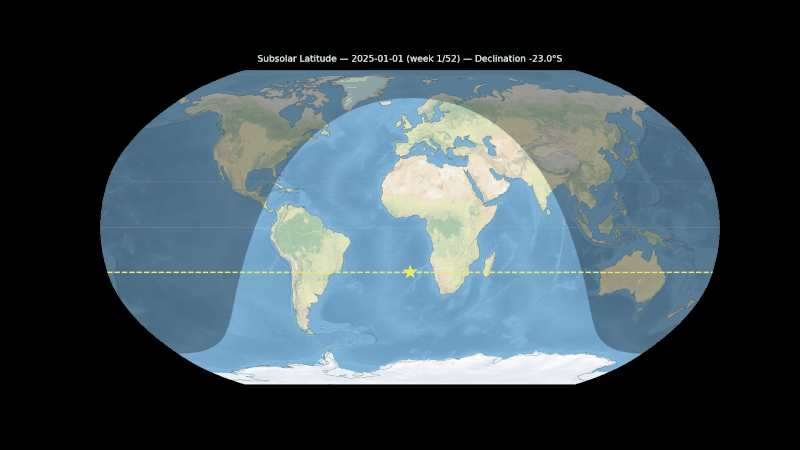
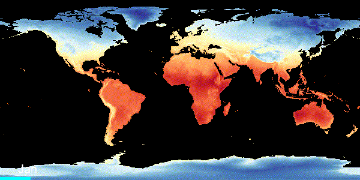
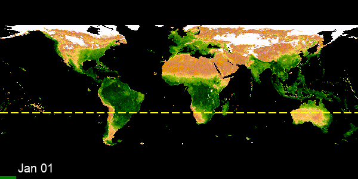

The Earth's axis is tilted by 23.4° — and that single fact drives everything we call "seasons." These three animations show the chain of consequences:

1️⃣ Subsolar latitude migration — The latitude where the Sun is directly overhead oscillates between 23.4°N (June) and 23.4°S (December) over the year. The yellow dashed line traces this annual migration week by week.

2️⃣ Global temperature by month — The shifting sunlight drives a hemispheric temperature seesaw. Continental interiors (Siberia, Canada) swing between extremes, while oceans barely change — water stores heat much better than land.

3️⃣ Vegetation from space (NDVI) — Temperature and moisture control where plants grow. This isn't real satellite images — it's a false-color visualization where green intensity represents the NDVI vegetation index, computed from how strongly plants reflect near-infrared light. You can watch a "green wave" sweep northward in boreal spring and retreat in autumn. The yellow line marks the subsolar latitude again — vegetation follows the Sun.

Built with ERA5 reanalysis data (ECMWF), MODIS satellite imagery (NASA), and Cartopy/Google Earth Engine.
