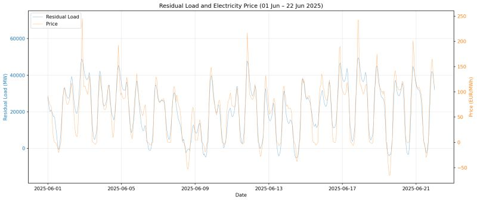
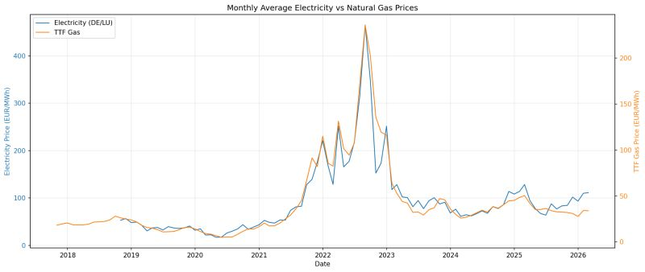

German electricity prices are a story of two different timescales. On a daily timescale they are primarily driven by the Residual Load—the "gap" that remains after subtracting volatile renewable generation (wind and solar) from total demand. As seen in the first chart, when renewables are high, the residual load drops, often pushing prices toward zero. Conversely, when the wind isn't blowing and the sun isn't shining, we must rely on conventional power plants to fill the deficit, causing immediate price spikes to balance the grid.

*Hourly residual load and electricity price, 1–22 June 2025: low residual load goes along with prices near or below zero.*

On a macro level, these prices are governed by the Merit Order, where the market clearing price is set by the marginal costs of the most expensive producer required to meet demand. Because gas-fired plants are frequently the final units called upon to bridge the gap, electricity prices remain structurally tethered to natural gas markets. As the second chart confirms, as long as we depend on gas to match our peak residual load, our power prices will continue to mirror the volatility of global gas costs. (note: I did the chart some weeks ago, so it does not yet reflect the most recent rise in gas prices)

*Monthly average electricity prices (DE/LU) and TTF natural gas prices, 2018–2026.*
