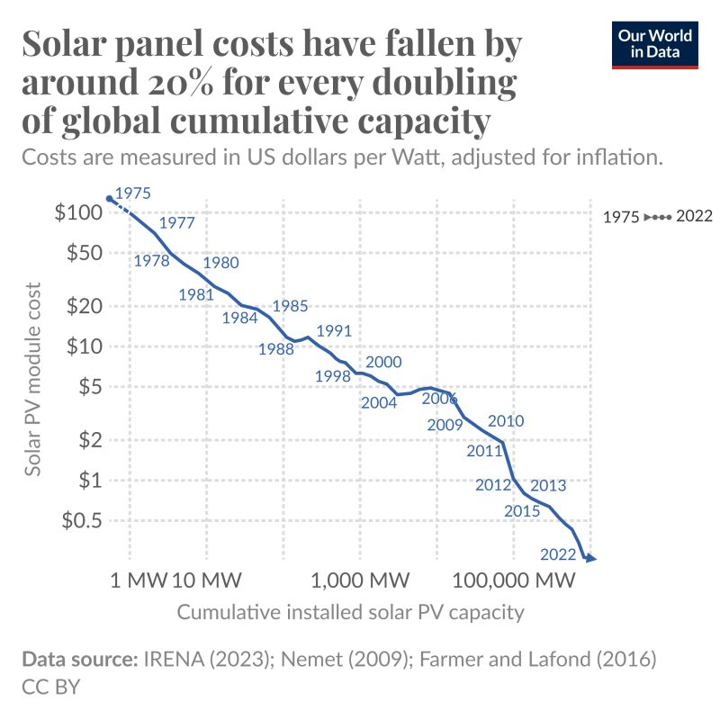
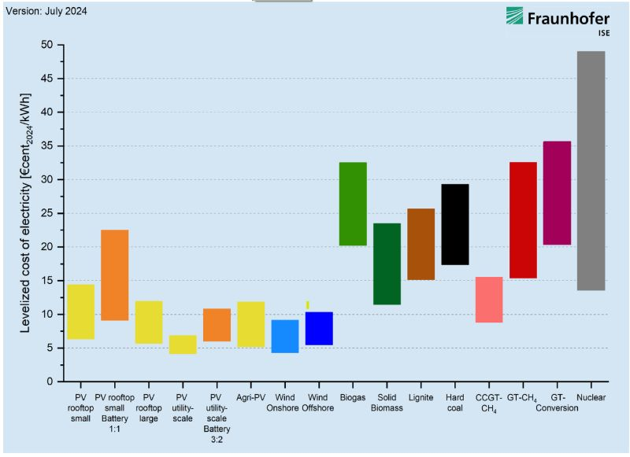

The dramatic decline in solar costs is a powerful reminder of what is possible when technology scales globally. As the first chart from Our World in Data shows, for every doubling of cumulative capacity, module prices dropped by about 20%—moving from over $100/Watt in 1975 to just cents today.

*Solar module prices fall by about 20% with every doubling of cumulative capacity. Source: Our World in Data.*

This historical learning curve led to the modern energy landscape shown in the July 2024 Fraunhofer ISE study. The chart compares the Levelized Cost of Electricity (LCOE). It takes the total cost to build, operate, and maintain a power plant over its entire lifetime and divides it by the total electricity it will generate. It lets us compare apples to oranges—like solar vs. coal. Utility-scale solar is now definitively one of the lowest-cost sources available.

*Levelized Cost of Electricity (LCOE) across technologies. Source: Fraunhofer ISE, July 2024.*
