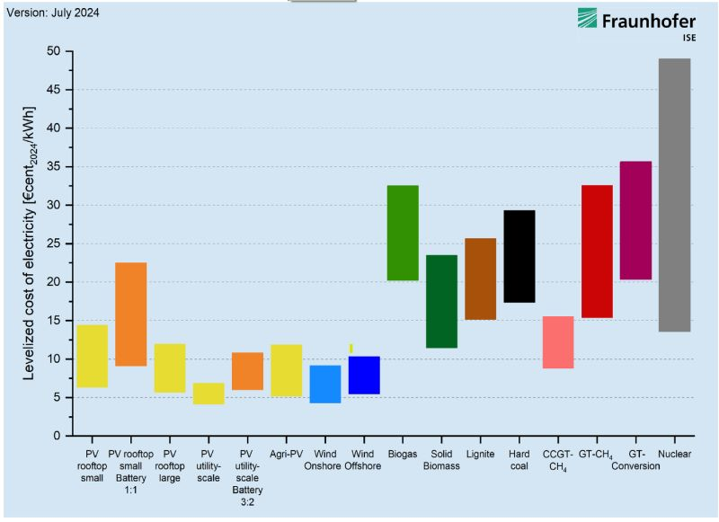
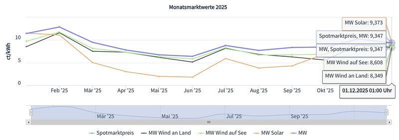

While the Levelized Cost of Electricity (LCOE)—the lifetime break-even cost per unit of energy—proves utility-scale solar is incredibly cheap to build, this metric has a major blind spot: it completely ignores when the electricity is generated. In reality, a kilowatt-hour is only truly valuable if it is produced at the exact moment the grid actually needs it.

*LCOE ranges by technology. Source: Fraunhofer ISE, July 2024.*

This timing issue creates the "cannibalization effect," perfectly illustrated by the Monatsmarktwerte (monthly market values or capture prices) chart from Netztransparenz. A technology's Monatsmarktwert is computed as its volume-weighted average electricity exchange price over a month. As the chart shows, volume-weighted solar prices in the summer are consistently below the overall average market prices, indicating that solar tends to enter the market when there is already a massive supply, which drives the price down.

*Monthly market values (Monatsmarktwerte) 2025 for solar, wind and the spot price. Source: Netztransparenz.*

Because of this, if a solar plant produces 100 MWh, but 20 MWh are generated when the residual load is already negative, we really only get 80 useful MWh. To be fully accurate, our LCOE calculations need to reflect this reduced useful output. The key to fixing this ratio is adding flexibility to the grid. This requires a two-pronged approach: shifting demand—like smartly timing when we charge our EVs to align with peak sunshine—or deploying battery storage to save that excess midday generation for the evening peak.
