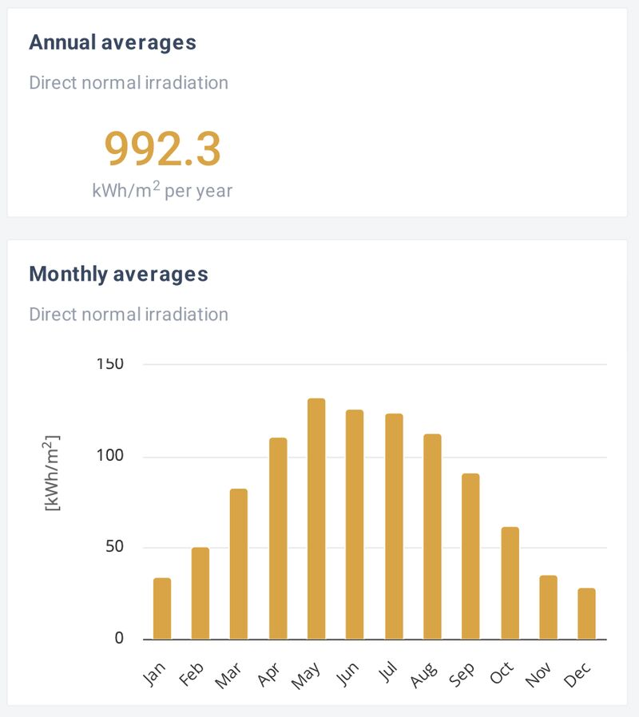
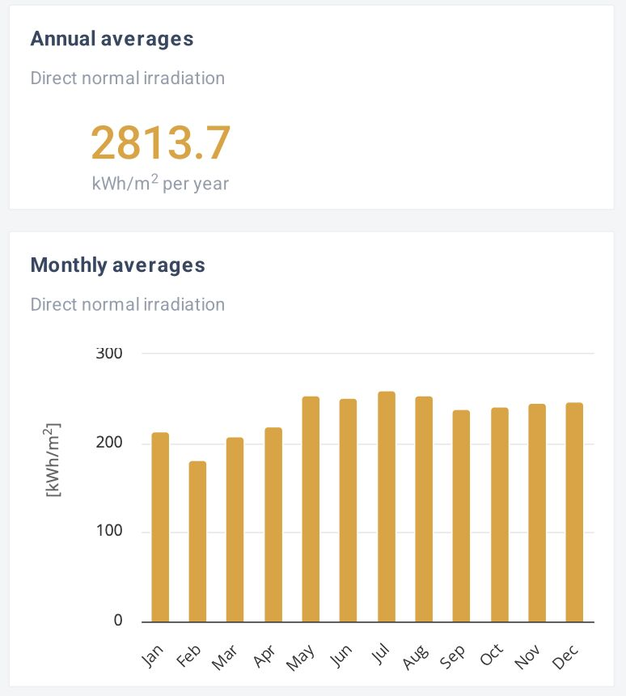
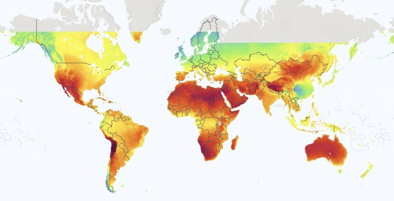

In terms of LCOE (levelized costs of energy), solar is already the cheapest power source in Germany. But its potential is even higher in other regions. When you look at the raw solar fuel—the Direct Normal Irradiation (DNI)—available globally, the geographical advantages become undeniable. Comparing [GlobalSolarAtlas.info](http://GlobalSolarAtlas.info) data puts this into stark perspective: an identical solar panel in Windhoek, Namibia, has almost 3 times the raw energy to work with compared to one in Berlin, Germany (2,813 kWh/m² annually vs. 992 kWh/m²). Crucially, Windhoek also has much less seasonality. Its worst winter month for solar irradiation still significantly outperforms Berlin's absolute best summer month, highlighting exactly why northern climates require massive seasonal storage to bridge their winter energy gaps.

*Berlin: 992 kWh/m² per year, strongly seasonal. Source: Global Solar Atlas.*

*Windhoek: 2,814 kWh/m² per year, with little seasonal variation. Source: Global Solar Atlas.*

However, latitude isn't the only factor dictating solar potential. If you look closely at the global map, China’s solar irradiation values are actually noticeably worse than other global regions at the exact same latitude. The primary explanation for this anomaly is "solar dimming" caused by high levels of atmospheric aerosols and air pollution. Dense smog and particulate matter physically scatter and absorb incoming sunlight before it can reach the ground. Interestingly, as China accelerates its clean energy transition and clears its air, these aerosol levels are dropping—creating a virtuous cycle where less pollution literally allows their newly installed solar panels to generate power even more efficiently.

*Global map of direct normal irradiation; note the low values over central China. Source: Global Solar Atlas.*
