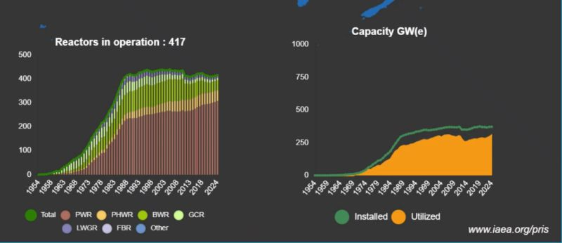
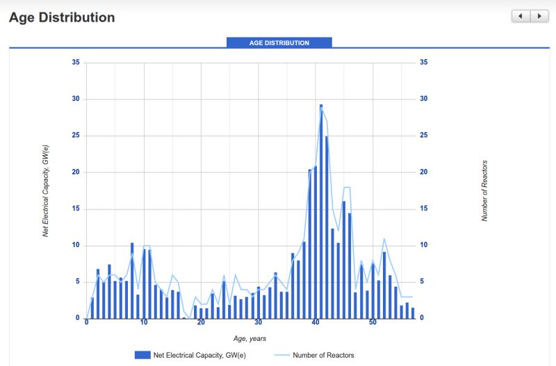
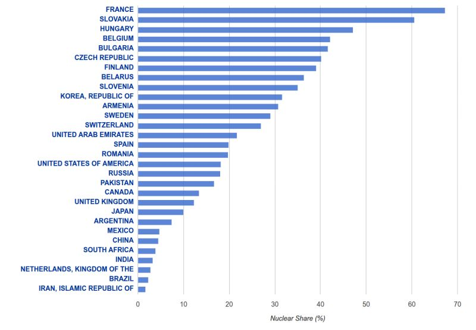
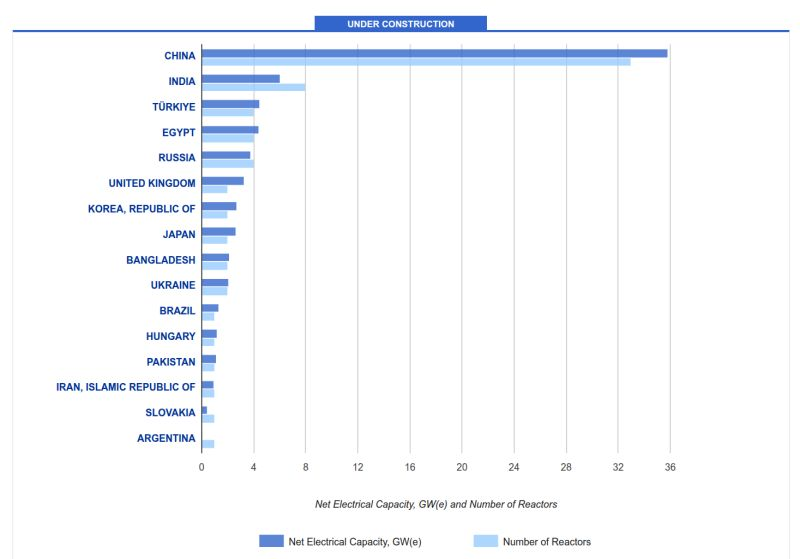
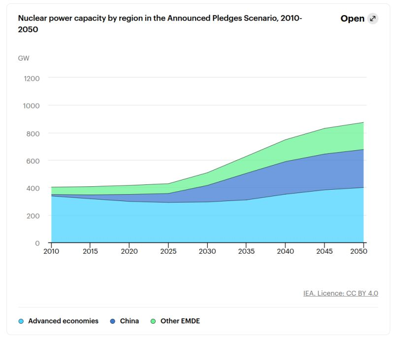

The nuclear energy debate comes up from time to time, but my impression is that it’s rarely discussed based on numbers, but rather based on emotions. That isn't very helpful if you actually want to understand the realities of the topic. So, I went directly to the IEA and the IAEA PRIS database to look up the hard data for myself.

Historically, the lifecycle of nuclear power is strikingly clear. The world experienced a massive construction boom throughout the 1960s, 70s, and 80s, followed by decades of profound stagnation. This pause is perfectly mirrored in the age distribution chart: we currently have a rapidly aging global fleet, with a massive cluster of reactors hitting the 40-year mark.

*Reactors in operation and capacity (GW) worldwide, 1954–2024. Source: IAEA PRIS.*

*Age distribution of the global reactor fleet. Source: IAEA PRIS.*

Today, the approach to nuclear varies wildly depending on where you look. Globally, nuclear energy provides roughly 9-10% of our total electricity. But the national charts highlight extreme contrasts. Germany's direct neighbor, France, relies on nuclear for a staggering 67% of its power, while Germany has executed a complete nuclear exit. Other major players show varied reliance—the US sits at roughly 18%, while China is currently around 5%.

*Nuclear share of electricity generation by country. Source: IAEA PRIS.*

So, what is next? Data from current construction pipelines shows that global capacity will increase in the near term, but the center of gravity has completely shifted. Future capacity is currently being dominated by massive new builds in China.

*Reactors under construction by country (capacity and number of reactors). Source: IAEA PRIS.*

Long-term projections point toward a global nuclear revival based on new international pledges, but those future targets remain much less certain than actual steel in the ground.

*Nuclear capacity by region in the IEA's Announced Pledges Scenario, 2010–2050. Source: IEA.*
