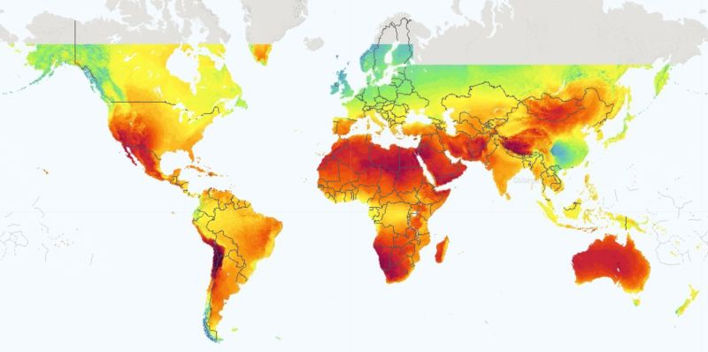
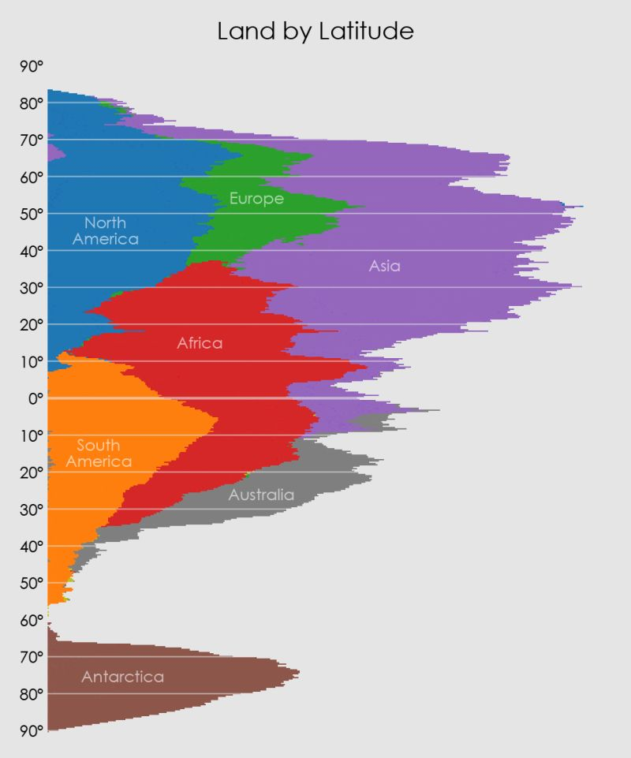
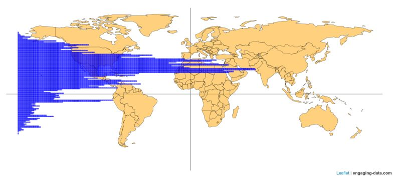

You might assume the Equator—where the sun hits most directly—would be the ultimate solar energy goldmine. But if you look at the Global Solar Atlas, the real "sweet spots" (the deep reds) aren’t at 0° latitude. Instead, they are concentrated in the subtropics (15°N to 35°N and 15°S to 35°S).

*Solar resource map. Source: Global Solar Atlas (World Bank Group/Solargis).*

☁️ The Cloud Belt Problem

The Equator is a massive "cloud machine." Because of the Hadley Cell atmospheric circulation, intense heat causes air to rise, cool, and condense, creating a near-permanent belt of clouds and rain (the ITCZ). This reflects a massive amount of solar radiation before it ever hits a panel.

In contrast, the subtropics are where that dry air finally sinks, suppressing cloud formation. This is why the world’s great deserts—the Sahara, Arabian, and Atacama—sit there. They have the clearest skies and lowest humidity on Earth.

🗺️ The "Northern Bias" of Humanity

While the Southern Hemisphere has incredible solar potential (like the Australian Outback), the distribution of landmass and population is heavily biased towards the Northern Hemisphere.

Landmass: As shown in the "Land by Latitude" visualization by Andy Woodruff, the Southern Hemisphere virtually "disappears" below 45°S. Roughly 68% of Earth's land is in the Northern Hemisphere.

*Land distribution by latitude. Source: Andy Woodruff (A Pile of Continents).*

Population: According to data from Engaging Data, a staggering 90% of the human population lives north of the Equator.

*World population distribution. Source: Engaging Data.*
