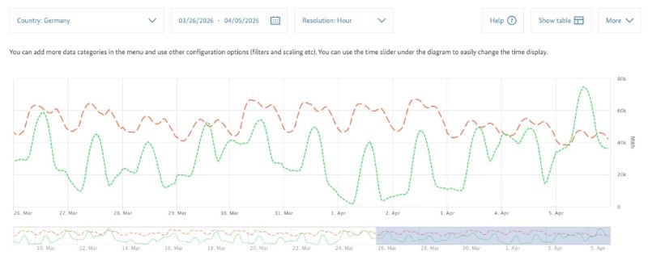
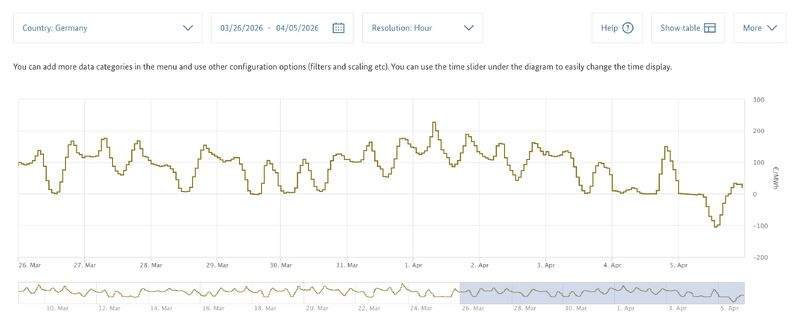
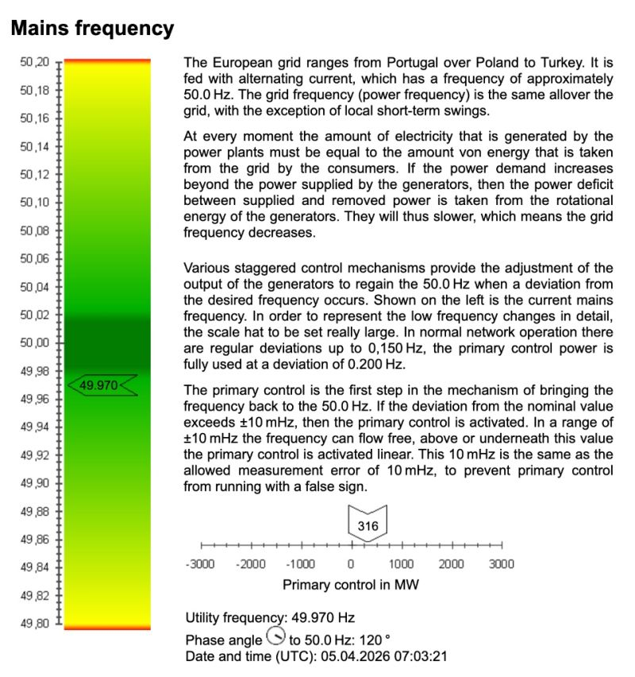

Good morning from Germany where the Easter Bunny is bringing another challenge for our energy grid! ☀️🔋

While most of the country is enjoying a quiet holiday morning, the German grid operators are preparing to face a "stress test" to the power grid. Here is what happens when a sunny public holiday meets a modern renewable infrastructure:

The Surpluss Peak: As shown in the SMARD data, forecast renewable generation (the green line) has surged to nearly 80 GW, while forecast holiday consumption (the red line) is hovering around 40 GW. We are producing double what we are consuming.

*Forecast renewable generation vs. forecast consumption, 26 March – 5 April 2026. Source: SMARD.*

The Price Drop: Because of this massive oversupply, day-ahead prices have plummeted into negative territory, hitting roughly -€100/MWh. In the energy market, this is the economic signal to stop production or ramp up consumption immediately.

*Day-ahead electricity prices in Germany, 26 March – 5 April 2026. Source: SMARD.*

The Frequency Challenge: On a physical level, supply and demand must always be in perfect equilibrium to maintain a stable frequency of 50 Hz. When they don't match, the frequency shifts—threatening the safety of the entire European network. You can track this "heartbeat" in real-time at [mainsfrequency.com](http://mainsfrequency.com).

*Live mains frequency of the European grid on Easter morning. Source: mainsfrequency.com.*

Why it matters: The energy transition is making life for grid operators significantly more complicated. Managing a system dominated by volatile weather-dependent sources—rather than predictable power plants—requires incredible precision and constant intervention. Today is a glimpse into a future that requires much more storage and flexible demand to keep the lights on.

A huge thank you and greetings to all grid operators and everyone working in control rooms across Europe today. While we enjoy our Easter brunch, they are working hard behind the scenes to keep our frequency stable and the lights on.  
Happy Easter and stay balanced!
