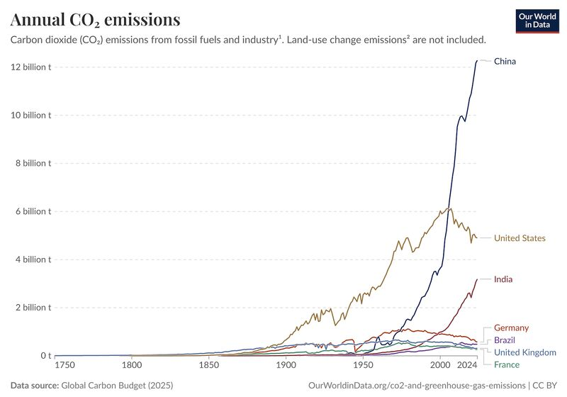
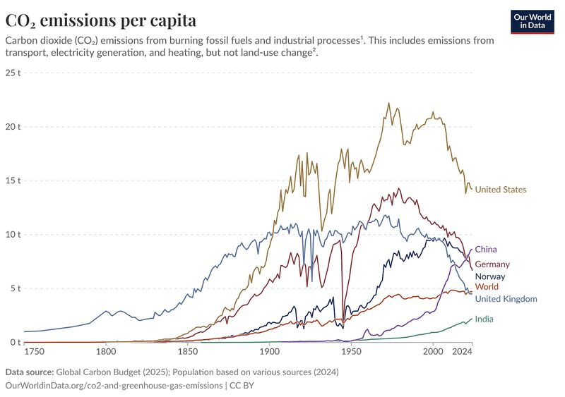
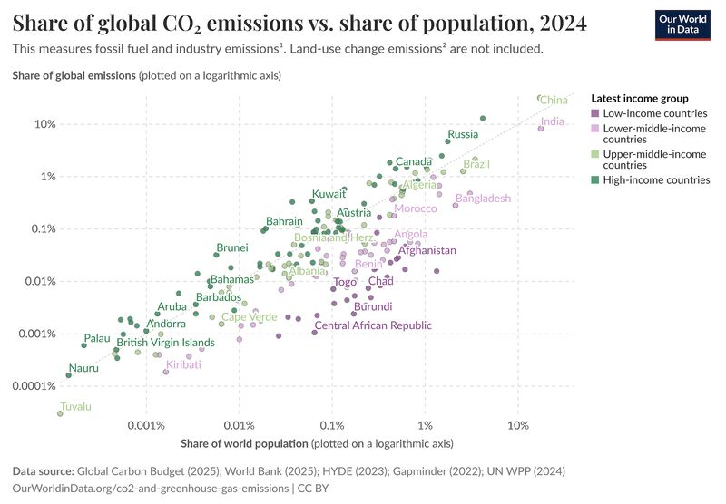
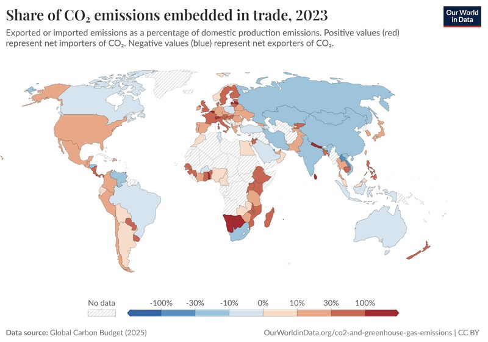

When judging a country’s climate impact, the "villain" changes depending on your metric.

1. The Scale Problem: Total vs. Per Capita

Emissions aren't just electricity—but also heating, transport, and industry. Hence, total annual emissions seems like a good first candidate, where China is a negative outlier.

*Total annual CO₂ emissions by country. Source: Our World in Data (Global Carbon Budget 2025).*

But this fails to account for population. When we normalize for emissions per capita, the story shifts: the United States and other wealthy nations often have a much higher individual footprint.

*Annual CO₂ emissions per capita. Source: Our World in Data (Global Carbon Budget 2025).*

2. The Prosperity Paradox

Emissions are historically tied to development. As seen in the Share of Global Emissions vs. Population, higher income usually equals higher pollution. All nations strive for prosperity; the real test is whether a country can "decouple" growth from carbon, reaching high-income status without the traditional emissions spike.

*Share of global emissions vs. share of population. Source: Our World in Data (Global Carbon Budget 2025).*

3. Outsourcing the Footprint

Finally, we must account for embedded emissions in trade. Many Western nations (in red) appear "cleaner" only because they import carbon-intensive goods. If Germany or the US buys steel produced in China, the emissions stay on China’s books, but the demand comes from the West.

*CO₂ emissions embedded in trade. Source: Our World in Data (Global Carbon Budget 2025).*

The Bottom Line

To evaluate a country fairly, don't just look at their chimney stacks. Look at their per capita consumption and their imported carbon.
