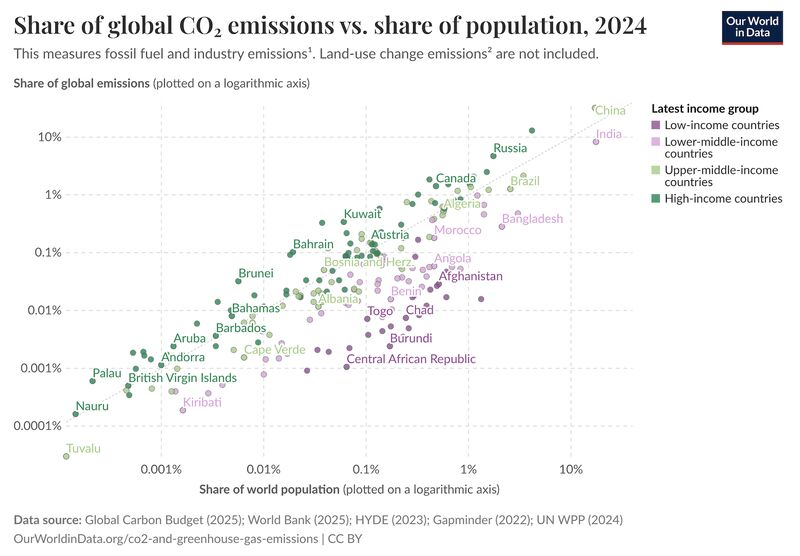
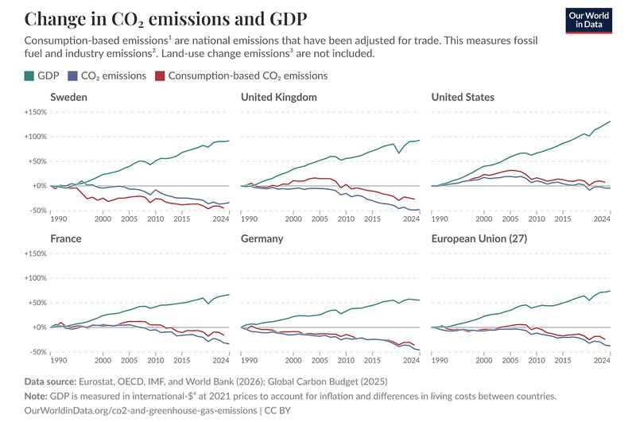
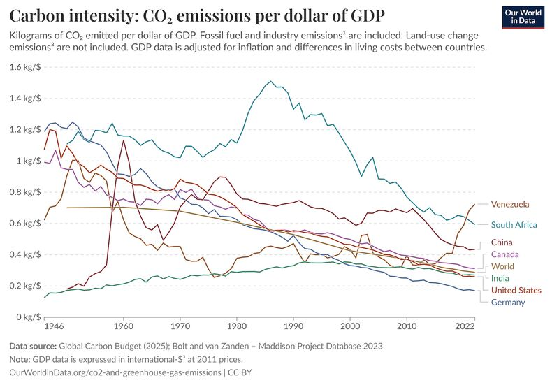

Historically, economic growth and CO₂ emissions were locked together: to get richer, you had to burn more. But the latest data shows this "iron law" is finally breaking.

The Historical Pattern

As the Emissions vs. Population chart shows, wealth and carbon are still highly correlated. High-income nations dominate the top-right, while low-income nations sit at the bottom-left. For decades, "development" meant climbing this carbon ladder.

*Share of global CO₂ emissions vs. share of population, 2024. Source: Our World in Data.*

The Great Decoupling

The breakthrough is absolute decoupling. As seen in the Change in CO₂ and GDP chart, countries like the UK, Germany, and France have seen GDP rise while emissions fall. Importantly, this holds true even for consumption-based emissions (red line), proving these nations aren't just "outsourcing" their pollution—they are becoming fundamentally more efficient.

*Change in GDP, CO₂ emissions and consumption-based CO₂ emissions since 1990. Source: Our World in Data.*

Falling Intensity

This shift is driven by a collapse in Carbon Intensity—the amount of CO₂ emitted per dollar of GDP.  
The West: Has seen a steady decline for decades.  
China: After a massive industrial spike in the early 2000s, its intensity is now falling sharply, suggesting it may be the next major economy to further decouple growth from carbon.

*Carbon intensity: CO₂ emissions per dollar of GDP. Source: Our World in Data.*

The goal is no longer to sacrifice prosperity for the planet, but to prove that modern economies can thrive while the carbon line heads toward zero.
