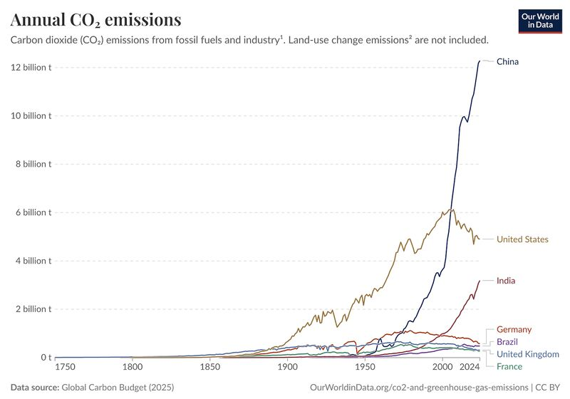
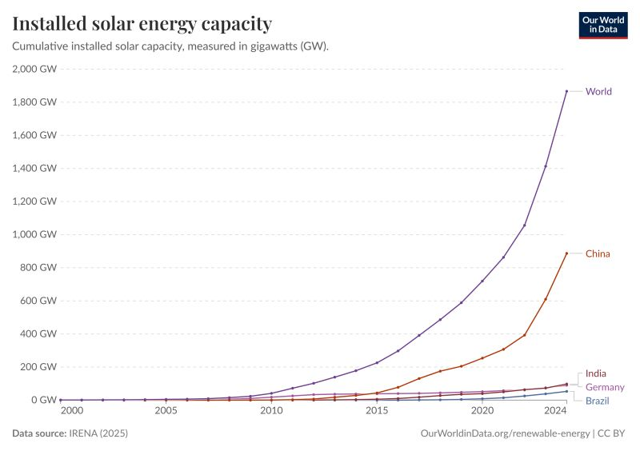
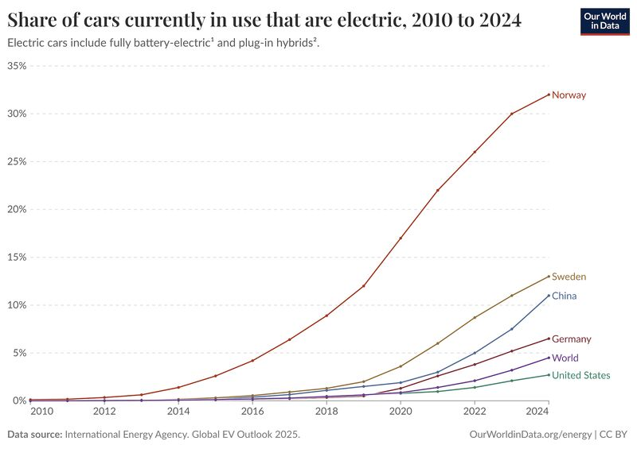
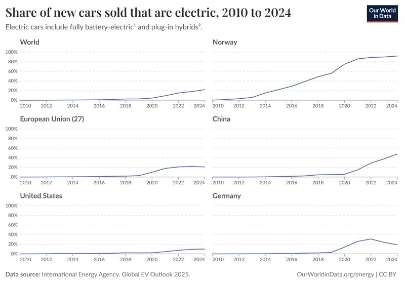
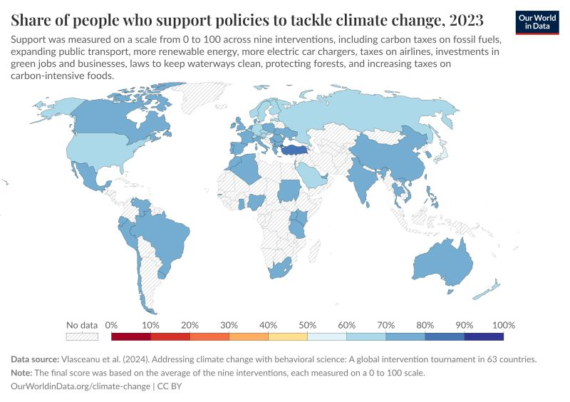

While China is often headlined as the world’s largest emitter, there are some aspects that actually make me somewhat optimistic about their role.

*Annual CO₂ emissions from fossil fuels and industry. Source: Our World in Data (Global Carbon Budget 2025).*

1. The Solar Superpower

China’s commitment to renewables is staggering. As shown in the Installed Solar Capacity chart, China is not just leading; it is in a league of its own. In 2024 alone, China installed more solar capacity than the total cumulative capacity of Germany. This massive scale-up is the primary reason solar PV prices have plummeted globally, making clean energy affordable for the rest of the world.

*Cumulative installed solar capacity in GW. Source: Our World in Data (IRENA 2025).*

2. Leading the EV Revolution

The transition isn't limited to the power grid. In the transport sector, China has surged ahead of traditional automotive leaders. The Share of Electric Cars charts show China rapidly outpacing Germany and the US. By betting early on battery supply chains and infrastructure, China has made electric mobility a mass-market reality while others are still navigating the transition.

*Share of cars in use that are electric, 2010–2024. Source: Our World in Data (IEA Global EV Outlook 2025).*

*Share of new cars sold that are electric, 2010–2024. Source: Our World in Data (IEA Global EV Outlook 2025).*

3. Public Will for Change

Contrary to the "top-down" stereotype, there seems to be deep public resonance for climate action. The Support for Climate Policies map reveals that the Chinese population shows some of the highest levels of support globally for interventions like carbon taxes and more renewable energy.

*Share of people who support policies to tackle climate change, 2023. Source: Our World in Data.*
