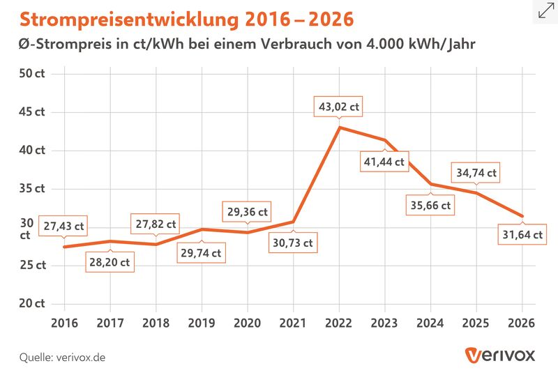
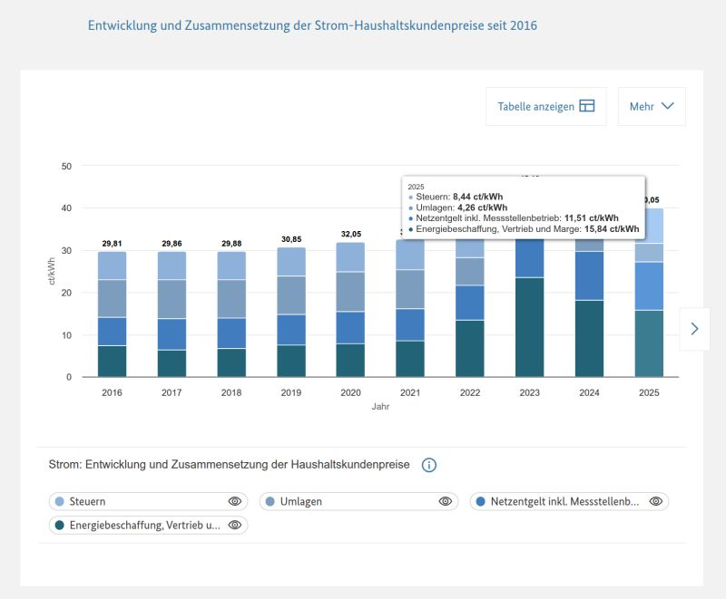
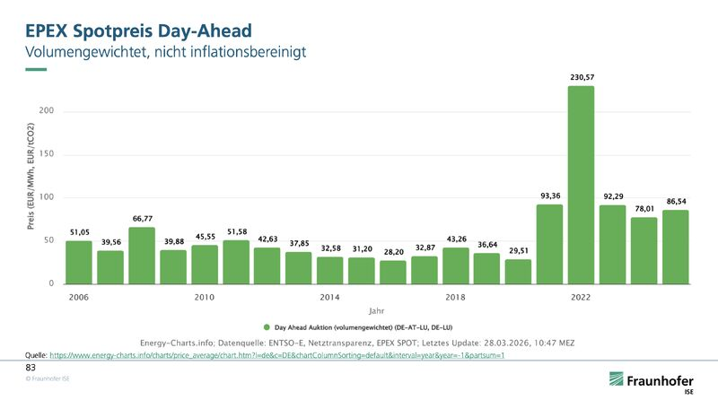
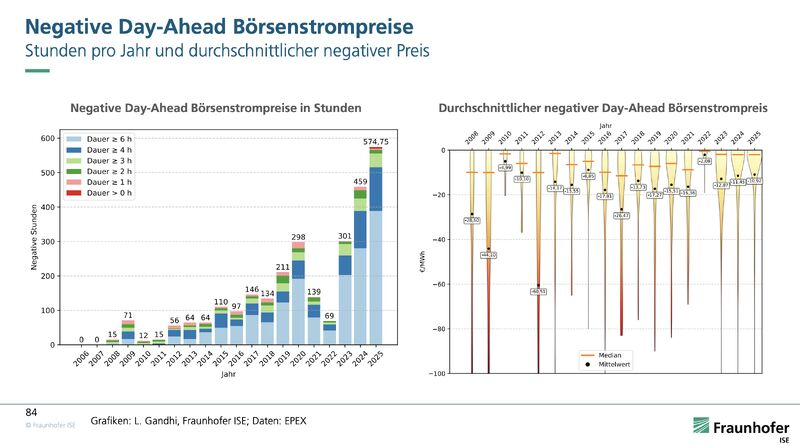
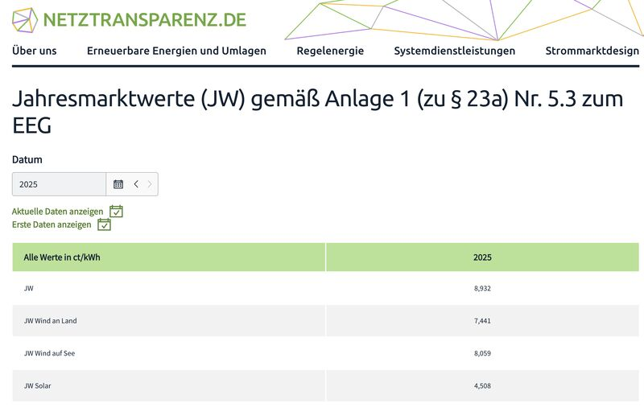

When people talk about electricity prices, they often mean very different things. To make the debate more factual, it helps to break the price down into its layers.

**The household price:** This is the end-customer price including taxes and grid fees. The latter cover the cost of the physical infrastructure and vary regionally, depending on the distribution grid operator. Important: this is not the industrial price, since large consumers are often exempt from many levies.

*Average household electricity price in ct/kWh, 2016–2026. Source: Verivox.*

**The supplier layer:** This is where the transformation happens. Customers usually want prices that are stable over the long term so they can plan. The supplier manages the risk and smooths out the volatile exchange prices. The downside: the price incentive to consume less when electricity is expensive is often lost for the end customer.

*Composition of household electricity prices since 2016. Source: SMARD.*

**The power exchange:** In day-ahead trading, the merit order rules. The most expensive power plant still needed to cover demand sets the price. Often these are gas-fired plants (including emission costs). On very sunny or windy days, renewables push the price down, sometimes into negative territory.

*Volume-weighted day-ahead spot price (not inflation-adjusted). Source: Fraunhofer ISE (Energy-Charts).*

*Hours with negative day-ahead prices per year and the average negative price. Source: Fraunhofer ISE, L. Gandhi; data: EPEX.*

**The solar market value (capture price):** As an operator, you do not earn the average exchange price. Since all solar plants feed in at the same time, they correlate with an oversupply that pushes the price down in exactly those hours. This "revenue value" is about 4.5 ct in 2025, almost 50% below the exchange average.

*Annual market values 2025 by technology. Source: Netztransparenz.*

To put the orders of magnitude into perspective, here is an overview of rounded values in ct/kWh for two different years:

- Household price: 29 (2018) → 37 (2025) (see Verivox chart)
- Electricity supplier (procurement & sales): 7 (2018) → 16 (2025) (see SMARD chart)
- Power exchange: 4 (2018) → 9 (2025) (see charts from [Fraunhofer ISE](https://de.linkedin.com/company/fraunhofer-ise-freiburg) and [Leonhard Gandhi](https://de.linkedin.com/in/leonhard-gandhi-4b2666284))
- Solar market value (capture price): 4.5 (2018) → 4.5 (2025) (see Netztransparenz chart)

**Why an international price comparison is so difficult**

Pure exchange prices are often misleading because they ignore system costs. A system with a lot of renewables needs more grids (infrastructure), the costs of which are in principle financed through the electricity bill in Germany. In the past, exchange revenues often did not suffice to cover the high fixed costs (CAPEX) of renewables; the difference was covered by the EEG levy.

A look at France shows the other extreme: there, the massive costs of building and maintaining nuclear power plants are often directly supported by the state. The electricity bill of French citizens therefore does not reflect the full system costs, since part of them is financed through general tax revenue. In Germany, by contrast, almost the entire truth is in the electricity bill.
Simply quoting cent amounts per kilowatt-hour therefore falls short if one does not consider which infrastructure and subsidy costs are included in the price in each case, or hidden in the state budget.
