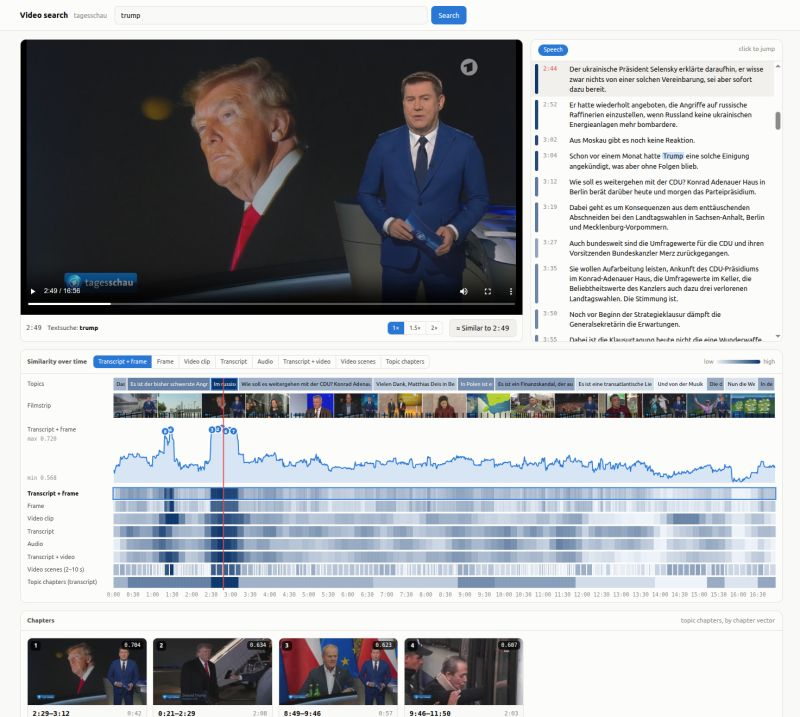
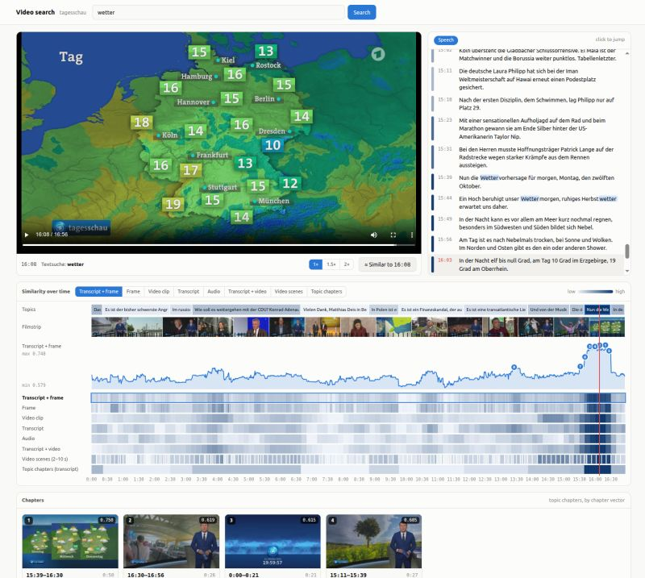

I've always wanted to understand how you make videos properly searchable. So I built a small project with open models running locally on my laptop.

My test video was a 17-minute episode of the Tagesschau, the German evening news. The two screenshots show two searches:

🔎 "Trump": two clear peaks on the timeline. One is the question to Trump about whether the US will get involved in the Saudi Arabia conflict; the other is his claim about an "energy ceasefire" between Russia and Ukraine. The chapter list ranks that Ukraine segment first.  
🔎 "Wetter" (weather): all top hits fall within the weather forecast at the end, and the matching chapter scores far above all others.

The setup:  
- Parakeet (NVIDIA) transcribes the speech.  
- EmbeddingGemma 2 puts text, frames, video clips and audio into one shared vector space.  
- A small browser GUI lets you search the video by text and shows where along the timeline the query matches, down to the second.

Processing took about 1.5 minutes for the transcription and about 11 minutes for all embeddings. All embeddings together take about 5 MB.

Once you go further into the details you notice some fun challenges like how you could use the setup to split the video into chapters. A simple approach is to embed each transcript sentence, then find the best split into contiguous blocks with dynamic programming. It took about a second and found 10 of the 11 topic changes. But that's just one video and it will probably not work out of the box for movies or other content.

I really find it remarkable how far you get today with open models on consumer hardware in a short time. And since everything stays local, I'll probably let it loose on our family video collection next :-)

