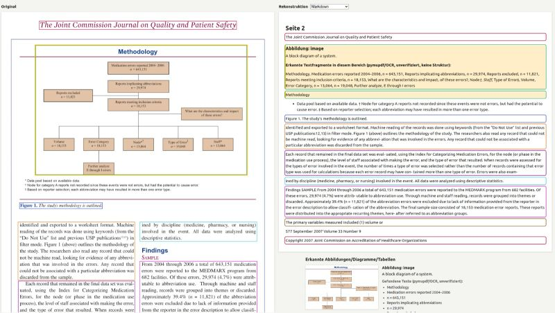

Only once you know which region of a page is running text, which is a table, which is a diagram, and which is a caption — only then can you decompose the page into clean Markdown: linear text in reading order, plus a description for every figure.

That Markdown representation is the key to two things:

→ A text embedding for semantic search  
→ And because it's plain text, it's trivially grep-able: exact terms, standard numbers, abbreviations, no embedding required

But a lot of the relevant information in technical documents isn't in the running text. It's in the components themselves: images, diagrams, tables. Those need to be just as discoverable, and a text description alone often isn't enough:

→ Image embeddings make diagrams searchable directly, even without a perfect text description  
→ Text embeddings of captions and generated diagram descriptions add semantic queries on top

The screenshot above shows exactly that first step: original page on the left, reconstructed Markdown representation on the right — running text, figure with its auto-detected text fragments, caption, all cleanly separated and in order.
