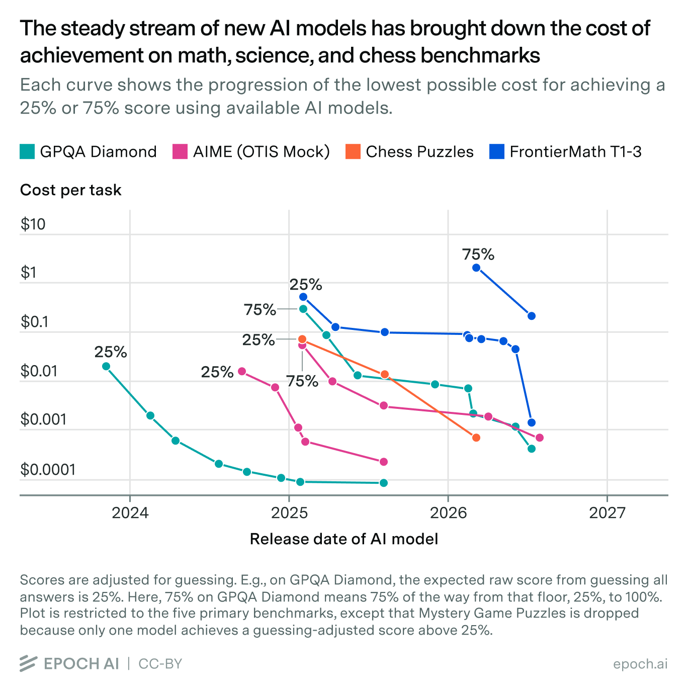
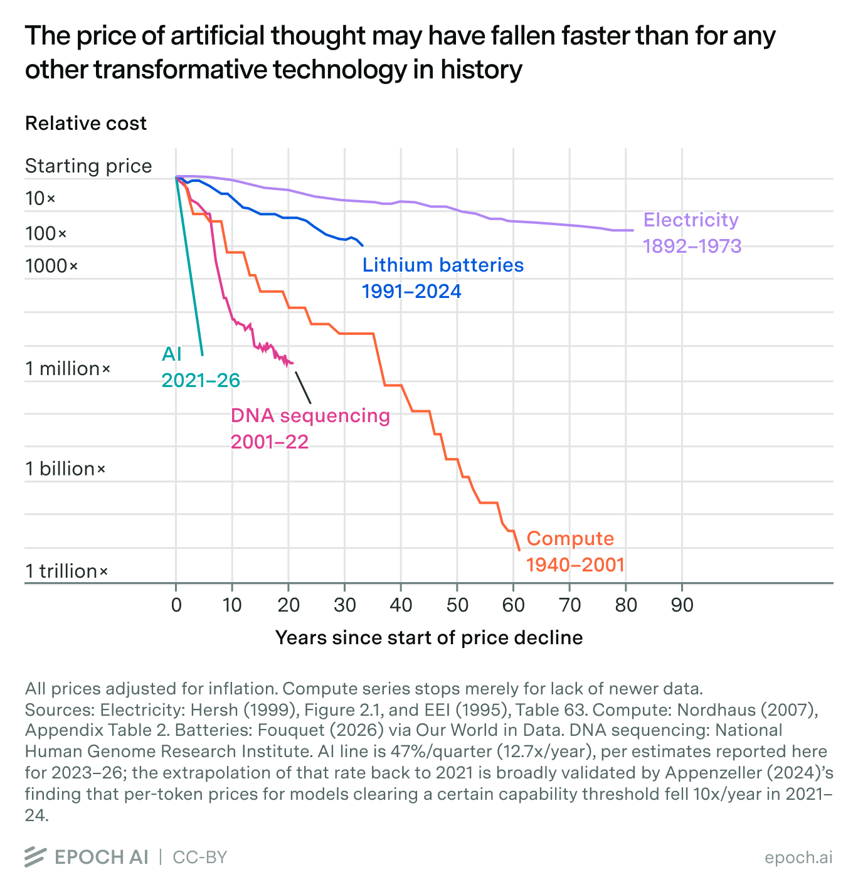
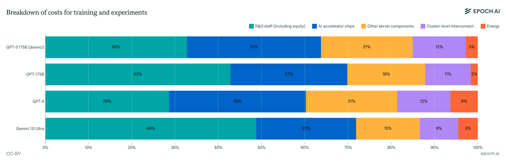
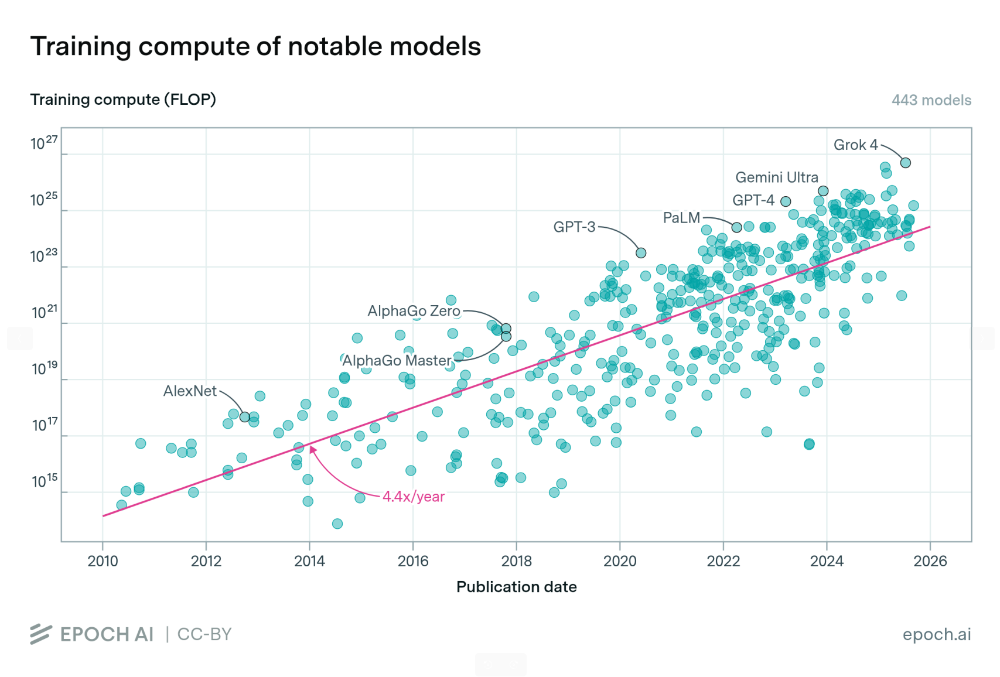
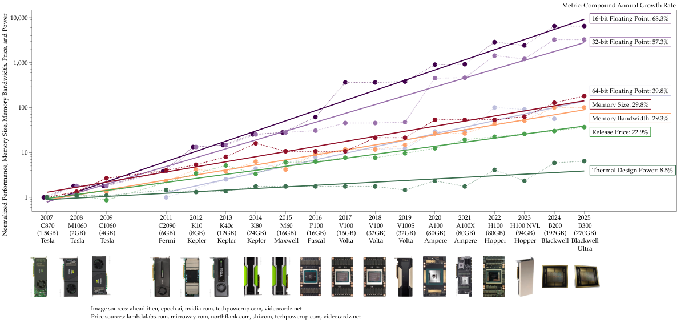
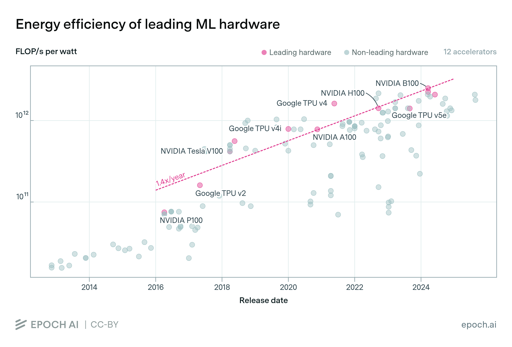
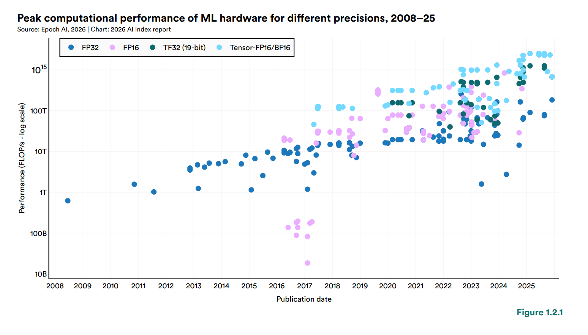
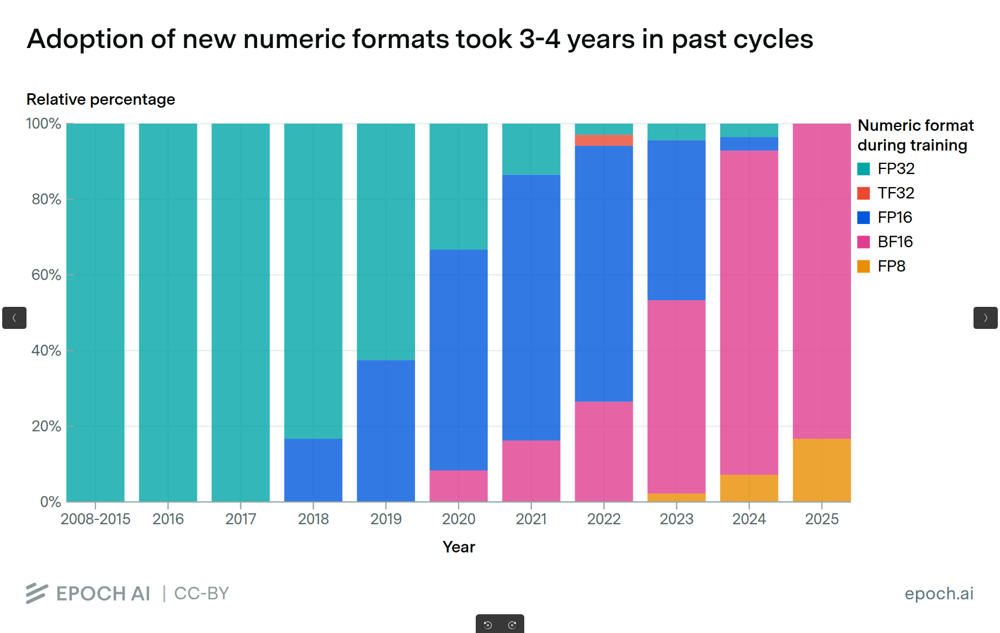

Estimating how AI prices evolve is not easy. A simple price comparison over the years doesn't work, because quality keeps changing: a 2023 model and a 2026 model don't deliver the same thing, even though both are "an AI model". So Epoch AI asks a different question: what does it cost to reach a given level of performance? This is measured on five benchmarks (mathematics, hard sciences, games). The chart shows, for four of them, how the lowest cost per task falls over time to reach the same score of 25% or 75%. With every new model, the same performance gets cheaper.

Indirectly, the chart also shows that AI is getting better: the 75% curves start later than the 25% curves, because a high level is only reached by a later model. On FrontierMath, for example, the 75% curve only appears in 2026. Every new curve stands for performance that wasn't available for purchase before, and then it, too, falls in price.

An example from Epoch AI's research article ["The plunging price of thought"](https://epoch.ai/publications/the-plunging-price-of-thought) (Luke Emberson, September 2026): OpenAI's o3 (January 31, 2025) reached a 75% score on GPQA Diamond (a multiple-choice exam at PhD level in physics, chemistry and biology) at an average cost of about $0.30 per question. Just under 18 months later, GPT-5.6 Luna reached the same score for $0.0004, roughly 725 times cheaper.

Of course, calculations like this rest on a number of assumptions, so they should be taken with a grain of salt. What Epoch AI measures is the actual cost per task, not the price per token, which matters because reasoning models consume a lot of tokens. And for open models without their own API, Epoch AI has to estimate the cost from rented hardware instead of API prices.

**Result:** Across all five benchmarks, the cost of a given performance level falls by about **47% per quarter, or roughly 13x per year** (since 2023). Right after a level is first reached, the price falls fastest (66% per quarter); two years later it falls only half as fast (32% per quarter).

## 2. A brief comparison with other technologies

Compared with other technologies such as electricity, lithium batteries, DNA sequencing or compute, AI has become cheap far more quickly.

The "price of thought" is much harder to measure than the price of a kilowatt-hour, so this comparison is also best taken with a grain of salt. Still, it indicates that costs are falling very fast, and Epoch AI considers this finding indisputable.

## 3. What do the costs consist of?

The question now is: where does this decline come from? A note up front: the figures below are outdated (models up to 2023) and mainly show which components the costs are made of. The orders of magnitude are likely quite different today. Epoch AI breaks down the cost of training and experiments for four models (GPT-3, OPT-175B, GPT-4, Gemini 1.0 Ultra) into five components:

- **R&D staff** (incl. equity): 29–49%
- **AI accelerator chips:** 23–32%
- **Other server components:** 15–21%
- **Cluster-level interconnect:** 9–12%
- **Energy:** 2–6%

What matters is the structure: it takes hardware (chips, servers, networking), power and people. That gives three levers for efficiency: faster hardware, more efficient hardware (less power) and more efficient software.

## 4. The apparent contradiction: compute demand per training run is rising

At the same time, the compute needed for the largest models is growing rapidly: the training compute of notable models rises by about 4.4x per year. Frontier models such as GPT-4, Gemini Ultra or Grok 4 are several orders of magnitude above AlexNet (2012).

If demand rises this sharply and the cost of a fixed performance level still falls, every unit of compute must have become much cheaper.

## 5. Hardware: faster, cheaper per unit of performance, and more frugal

For NVIDIA accelerators, compute performance grows much faster than price (annual growth rates, 2007–2025, source: [How Much Progress Has There Been in NVIDIA Datacenter GPUs?](https://arxiv.org/html/2601.20115v2)):

| Metric | Growth per year |
| --- | --- |
| Compute performance FP16 | 68.3% |
| Compute performance FP32 | 57.3% |
| Memory size | 29.8% |
| Memory bandwidth | 29.3% |
| Price | 22.9% |
| Power draw (TDP) | 8.5% |

So performance grows many times faster than price. And power draw (TDP) rises by 8.5% per year, much more slowly than compute performance: a Tesla C870 (2007) drew about 171 W, a Blackwell Ultra B300 about 1,100 W. Over the same period, compute performance rose by a far larger factor. So less and less power is needed per operation.

This can also be measured directly as energy efficiency: for leading GPUs and TPUs it has historically doubled every two years, about 40% per year ([Epoch AI](https://epoch.ai/data-insights/ml-hardware-energy-efficiency)). Example: an NVIDIA P100 (2016) delivers about 7.5 × 10¹⁰ FLOP/s per watt, an H100 (2022) about 1.4 × 10¹², roughly 19 times as much. The Blackwell chips B100/B200 (2024) reach about 2.3–2.5 × 10¹² (tensor FP16).

This lowers the power bill (in the older cost breakdown from section 3, energy was only a small share). But above all it limits how much compute can be run at one site: efficiency means more compute from the same power connection.

## 6. Software: making better use of the hardware

An important lever is precision. The [AI Index Report 2026](https://hai.stanford.edu/assets/files/ai_index_report_2026.pdf) (chapter 1.2, PDF page 29, data from Epoch AI) shows that the peak computational performance of ML hardware rose exponentially between 2008 and 2025. The increase is especially pronounced at lower precision, i.e. formats that use fewer bits per number. FP16 and tensor FP16/BF16 now reach the highest performance levels and have become standard in many training and inference setups.

In the chart (log scale), FP32 was still below 1 TFLOP/s in 2008 and is now at a few hundred TFLOP/s. Tensor FP16/BF16 reaches values on the order of 10¹⁵ FLOP/s. So the same chips deliver many times more operations per second at lower precision. The report also stresses that the growth in training compute (section 4) would not have been possible without such hardware improvements.

For this to pay off, software has to actually use the lower-precision formats. Adoption has so far typically taken 3–4 years to spread through the market:

- Until 2017, practically everything was trained in FP32.
- From 2018, FP16 took hold; from 2020, BF16 joined it.
- From 2023, FP8 appears. In 2025, the trainings shown run only in BF16 and FP8.

Fewer bits per number means: more operations per chip, less memory needed and less energy per operation. Hardware and software work together: new chips bring the formats, and training code uses them.

## 7. Conclusion

- **The cost of a given performance level falls** by roughly 13x per year (Epoch AI, 2023–26, measured as cost per task on five benchmarks).
- **Compute is becoming more efficient on three levels:** hardware (performance grows much faster than price), power (about 40% more efficiency per year) and software (lower precision, better utilization).
- **Training remains expensive anyway,** because compute demand required for state of the art models also increases
